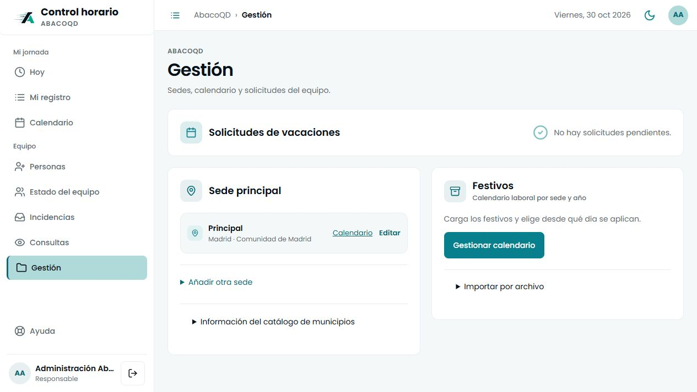
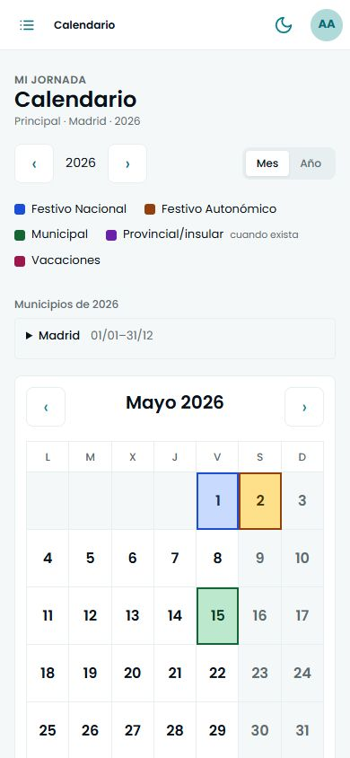
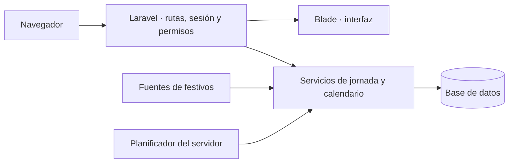

<p align="center">
  
</p>

<h1 align="center">Control horario · AbacoQD</h1>

<p align="center">
  Registro de jornada, vacaciones y calendarios laborales por municipio.<br>
  Cada fecha conserva la sede, el horario y el calendario que le corresponden.
</p>

<p align="center">
  <strong>Laravel 13 · PHP 8.3+ · Blade · SQLite · Vite</strong><br>
  536 pruebas verificadas · 3.807 aserciones · Catálogo de 8.132 municipios
</p>

<p align="center">
  <a href="#instalación">Instalación</a> ·
  <a href="#decisiones-de-diseño">Decisiones de diseño</a> ·
  <a href="#arquitectura">Arquitectura</a> ·
  <a href="#recorrido-de-revisión">Cómo revisarlo</a> ·
  <a href="#calidad-y-verificación">Pruebas</a> ·
  <a href="#documentación">Documentación</a>
</p>

## Qué resuelve

Registrar una entrada y una salida es sólo una parte del control horario. También hay que determinar si se esperaba trabajo ese día, qué horario estaba vigente, qué fiestas correspondían al centro y cómo conservar el contexto cuando una persona cambia de sede.

Esta aplicación reúne esas decisiones en un mismo flujo: fichaje confirmado por el servidor, planificación por fecha, vacaciones aprobadas, calendarios contrastados y correcciones con trazabilidad. La gestión diaria se organiza por perfiles y mantiene separados los registros laborales, las incidencias y el soporte técnico.

**La entrega está preparada para AbacoQD:** una instalación nueva comienza con la sede Principal de Madrid, sin cuentas, horarios ni actividad ficticia. El acceso inicial se crea expresamente y cada centro carga su calendario por municipio y año.



<details>
<summary><strong>Ver el calendario en móvil</strong></summary>

<p align="center">
  
</p>

Las casillas utilizan relleno completo y borde por tipo. La leyenda y el detalle de las fechas permiten consultar el significado del color. Las capturas corresponden al entorno de revisión con una cuenta administrativa genérica.

</details>

## Funcionalidad

| Área | Comportamiento disponible |
| --- | --- |
| Jornada | Entrada, pausa, vuelta y salida; tratamiento de jornadas anteriores abiertas y registro del trabajo realizado fuera del equipo. |
| Registro | Consulta por periodos, detalle de tramos, correcciones con autor y fecha, y exportación CSV. |
| Equipo | Altas, bajas con fecha y reincorporación, corrección del nombre y del fin de contrato con historial, horarios con fecha de efecto y asignación de sede. El estado del equipo filtra la lista al pulsar cada contador. |
| Vacaciones | Solicitud y decisión por la persona responsable; cálculo en días laborables según el calendario aplicable. Cada persona ve, para el año consultado, los días que le corresponden, los disfrutados, los aprobados, los pedidos y los que le quedan sin asignar, con sus periodos aprobados y rechazados. |
| Calendario | Búsqueda nacional por municipio o código INE, carga por año y sustitución completa o desde una fecha. |
| Avisos | Evaluación de la jornada prevista, avisos de inicio y seguimiento de cierres pendientes, con exclusiones por festivos y ausencias. |
| Incidencias | Comunicación, conversación, seguimiento por estados y archivo de las resueltas. |
| Soporte | Tickets entre la persona y el perfil técnico, respuestas y reapertura cuando corresponde. |
| Mantenimiento | Información del sistema, copia y restauración de SQLite en archivo y aplicación de migraciones pendientes. |

### Perfiles y responsabilidades

| Perfil | Responsabilidad |
| --- | --- |
| Trabajador (`trabajador`) | Registra su jornada, consulta sus datos, solicita vacaciones y comunica incidencias o tickets. |
| Responsable (`jefe`) | Gestiona personas, horarios, sedes y calendarios; decide vacaciones y consulta registros ajenos con un motivo registrado. También puede fichar su propia jornada. |
| Administración técnica (`tecnico`) | Atiende tickets y mantiene la instalación. Dispone de copia, exportación y restauración de la base; su interfaz no ofrece la consulta laboral de otras personas. |

Los permisos se comprueban en el servidor. La cuenta técnica debe reservarse a mantenimiento autorizado: una copia íntegra de la base contiene la información de la instalación, aunque no se muestre en sus pantallas de consulta.

Una cuenta técnica creada con `--solo-tecnico` se dedica exclusivamente a mantenimiento y soporte. No aparece en la plantilla laboral, no ficha, no pide vacaciones ni recibe avisos de jornada. Los técnicos existentes conservan su participación laboral; esta separación es explícita y no modifica sus registros. Los valores históricos de rol se migran a `jefe` y `trabajador` sin recrear cuentas.


## Decisiones de diseño

### 1. El pasado se consulta con su contexto

Se resuelven por separado **la sede aplicable a la persona** y **la versión del calendario aplicable al día**. Esto evita que el municipio actual reinterprete automáticamente todos los registros del año.

Por ejemplo, al aplicar el calendario de Segovia desde el 1 de febrero:

| Periodo | Calendario aplicable |
| --- | --- |
| 1–31 de enero | Se mantiene el calendario anterior de Madrid. |
| Desde el 1 de febrero | Se utilizan los festivos de Segovia confirmados para ese periodo. |

Las vacaciones y los fichajes permanecen guardados. Las versiones anteriores del calendario conservan su intervalo de vigencia. Elegir **Todo el año** sí sustituye el calendario desde el 1 de enero y debe utilizarse con esa intención.

La importación territorial admite una fecha de efecto dentro del año solicitado. El traslado personal entre sedes, en cambio, se aplica **desde hoy**: la versión actual no programa traslados personales futuros ni permite retrotraerlos libremente.

Implementación: [VigenciasCalendario](app/Services/VigenciasCalendario.php), [AsignacionesCentro](app/Services/AsignacionesCentro.php) y [User](app/Models/User.php).

### 2. La falta de información tiene un estado propio

El motor de jornada distingue tres resultados:

| Estado | Significado | Efecto sobre el aviso de inicio |
| --- | --- | --- |
| `laborable` | La fecha corresponde al contrato y al horario, existe cobertura confirmada y no hay descanso, festivo ni ausencia aprobada. | Puede evaluarse el incumplimiento de inicio según las reglas del horario. |
| `exento` | La fecha queda fuera del contrato o corresponde a descanso, festivo o ausencia aprobada. | No se exige iniciar la jornada. |
| `desconocido` | Falta el horario o la cobertura de calendario necesaria para decidir. | La planificación queda pendiente y no genera una falta automática. |

Un festivo conocido o una ausencia aprobada eximen aunque el resto del calendario esté pendiente. La persona puede registrar trabajo real cuando corresponda; la planificación y el registro de lo trabajado son conceptos diferentes.

Implementación: [JornadaService::expectativaDe](app/Services/JornadaService.php).

### 3. Los calendarios externos se contrastan antes de aplicarse

El buscador utiliza un catálogo local de **8.132 municipios de 2026**, cotejado con la referencia del INE. El código INE identifica el municipio y permite resolver provincia y comunidad sin depender de un nombre escrito libremente.

La consulta comprueba municipio, año, fechas, ámbito y estado de los datos. Combina fuentes oficiales disponibles con contraste entre proveedores, conservando la procedencia de cada importación. La aplicación distingue ambos tipos de comprobación.

Cuando la información es parcial, no está publicada, entra en conflicto o falla la consulta, se muestra el estado y **se conserva el calendario válido anterior**. Tener un municipio en el catálogo no garantiza que sus fiestas locales estén publicadas para cualquier año. El detalle de fuentes y la revisión necesaria quedan accesibles desde la gestión del calendario.

Implementación: [CalendarioMunicipal](app/Services/CalendarioMunicipal.php), [CatalogoMunicipios](app/Services/CatalogoMunicipios.php), [FestivosEspana](app/Services/FestivosEspana.php) y [fuentes de datos](docs/fuentes.md).

### 4. Corregir conserva la trazabilidad y el tiempo se cuenta una vez

Las correcciones guardan el valor anterior, el nuevo, el autor y el momento del cambio. Las operaciones críticas vuelven a comprobar el estado dentro de una transacción. Si existen tramos superpuestos, el total utiliza la **unión de los intervalos**, evitando sumar dos veces los mismos minutos.

Un tramo abierto de un día anterior tampoco utiliza la hora actual como una salida supuesta. La persona debe completar el cierre antes de iniciar la jornada siguiente. Las bajas cierran el acceso y conservan los registros.

Las regresiones de estos casos están recogidas en [JornadaTest](tests/Feature/JornadaTest.php) y [AuditoriaFlujosTest](tests/Feature/AuditoriaFlujosTest.php).

## Arquitectura

La aplicación es un monolito web con vistas renderizadas en el servidor. Laravel gestiona las peticiones, las sesiones y los permisos; los servicios concentran las reglas de jornada y las operaciones del calendario. Eloquent proporciona la persistencia y Vite construye los recursos del navegador.



| Componente | Responsabilidad |
| --- | --- |
| [`app/Http/Controllers`](app/Http/Controllers) | Entrada de las peticiones, validación y coordinación de los flujos web. |
| [`app/Services`](app/Services) | Jornada, vacaciones, calendario municipal, vigencias, asignaciones, tickets y mantenimiento. |
| [`app/Models`](app/Models) | Entidades, relaciones y consultas por fecha de aplicación. |
| [`database/migrations`](database/migrations) | Evolución del esquema y compatibilidad con los datos existentes. |
| [`database/data`](database/data) | Referencias públicas incluidas para la instalación del catálogo y la consulta de boletines. |
| [`resources/views`](resources/views) | Interfaz Blade; los estilos y scripts se construyen o sirven desde los recursos del proyecto. |
| [`tests`](tests) | Pruebas funcionales y unitarias, con datos y respuestas HTTP de referencia. |

La instalación documentada y verificada utiliza **SQLite en archivo**. Las operaciones de copia y restauración integradas están implementadas para ese modo de almacenamiento.

## Instalación

### Requisitos

| Requisito | Versión o condición |
| --- | --- |
| PHP | 8.3 o superior compatible con `composer.lock`; verificado con **8.4.27**. |
| Extensiones | Las requeridas por Composer y Laravel, especialmente `curl`, `mbstring`, `fileinfo`, XML, OpenSSL y PDO; `pdo_sqlite` para esta instalación. |
| Composer | Instalación desde `composer.lock`; verificado con **2.8.11**. |
| Node.js y npm | Node.js **24**; verificado con **24.22.1** y npm **12.2.0**. |
| SQLite | **3.35 o superior** para ejecutar la batería completa; verificado con **3.53.4**. |
| Acceso | El ZIP de esta versión. Conexión para instalar dependencias y consultar fuentes externas. |

Comprueba las extensiones del PHP de la terminal y las del servidor web. Node.js se utiliza para construir los recursos; el servidor final puede recibirlos ya construidos.

### 1. Obtener el código y preparar la configuración

Extrae el ZIP y abre una terminal dentro de la carpeta `abacoqd-control-horario`, donde están `artisan` y este README. No necesitas una cuenta de GitHub ni ejecutar `git clone`.

Crea la configuración local:

```bash
cp .env.example .env
```

En PowerShell, sustituye la última línea por:

```powershell
Copy-Item .env.example .env
```

Para la revisión local, conserva `APP_ENV=local`, `APP_DEMO=false`, `DB_CONNECTION=sqlite` y `MAIL_MAILER=log`. El archivo `.env` pertenece a esa instalación y queda fuera del repositorio.

### 2. Instalar dependencias y generar la clave

```bash
composer install
composer check-platform-reqs --lock
php artisan key:generate
```

Genera la clave después de crear `.env`. Consérvala al actualizar una instalación existente: forma parte de la configuración necesaria para recuperar el sistema.

### 3. Crear la base y preparar la sede

```bash
php -r "file_exists('database/database.sqlite') || touch('database/database.sqlite');"
php artisan migrate
php artisan db:seed
```

El arranque normal crea **Principal, Madrid — INE 28079** y el catálogo municipal. No crea usuarios, horarios, vacaciones ni fichajes de ejemplo. El calendario anual se carga expresamente desde Gestión.

### 4. Crear el acceso administrativo

```bash
php artisan abaco:crear-administrador correo@dominio.es "Administración"
```

La contraseña se pide dos veces, de forma oculta, y necesita al menos doce caracteres. La cuenta creada tiene el papel `jefe`. El comando rechaza un correo existente y no admite contraseñas en los argumentos.

Para crear una cuenta exclusivamente técnica, añade `--rol=tecnico --solo-tecnico`; para un trabajador, `--rol=trabajador`. Si hay varias sedes, selecciona una con `--centro=ID`. Crear una cuenta no le asigna una fecha de inicio ni un horario ficticios. La fecha de inicio del registro se indica con `--desde=AAAA-MM-DD` cuando se haya acordado.

### 5. Construir y arrancar

```bash
npm ci --ignore-scripts
npm run build
php artisan serve --host=127.0.0.1 --port=8000
```

Abre **http://127.0.0.1:8000/login** e inicia sesión con la cuenta creada. En **Gestión → Gestionar calendario**, selecciona el año y municipio, elige desde cuándo debe aplicarse y pulsa **Cargar / actualizar**.

El servidor de Artisan se utiliza para la revisión local. La instalación en servidor debe servir la carpeta `public/` y configurar su entorno, permisos, HTTPS, correo, planificador y copias. El procedimiento está en [instalación y operación](docs/instalacion-operacion.md).

## Recorrido de revisión

Utiliza una instalación de prueba y cuentas ficticias para recorrer los distintos perfiles.

| Paso | Qué comprobar |
| --- | --- |
| Jornada y registro | Fichar entrada, pausa, vuelta y salida; abrir el detalle y descargar el CSV. |
| Vacaciones | Solicitar un periodo con una cuenta de plantilla y aprobarlo o rechazarlo desde Gestión. |
| Calendario | Cargar Madrid, seleccionar otro municipio y aplicar el cambio desde una fecha; comprobar que el periodo anterior conserva su calendario. |
| Información pendiente | Revisar un año o municipio sin datos suficientes; comprobar el mensaje y la conservación del calendario anterior. |
| Soporte | Abrir un ticket, responder con el perfil técnico y revisar el estado de la conversación. |
| Uso diario | Probar el buscador con teclado, el menú móvil y las vistas clara y oscura. |

La restauración efectiva de una copia debe ensayarse en una instalación aislada compatible, conservando antes la base y la configuración de destino.

## Calidad y verificación


| Comprobación | Resultado registrado |
| --- | --- |
| Batería completa | **536 pruebas correctas · 3.807 aserciones** el 10 de noviembre de 2026, sin errores, fallos ni omisiones. |
| Instalación | Migraciones, catálogo local y sede inicial preparados desde una base vacía. |
| Recursos | Construcción Vite para `/controlhorario`; CSS y fuentes servidos desde esa subruta. |
| Prueba HTTP del paquete | **95 comprobaciones correctas**: accesos, permisos, CSRF, cookies, recursos y soporte. |
| Despliegue HTTPS real | **116 comprobaciones correctas** con una base temporal y cuatro accesos sintéticos. |
| Revisión visual y funcional | **Completada**, con las correcciones finales verificadas: navegador a **320, 390, 430 y 1.280 píxeles**; jornada, corrección, vacaciones, personas, soporte, menú y temas. No equivale a una prueba en teléfono físico. |
| Cierre de la revisión | Base definitiva restaurada, integridad y copia correctas, cero cuentas o actividad de prueba y credenciales sintéticas rechazadas desde la interfaz. |
| Caché de robots | Resuelta tras la purga realizada por el usuario: a las 13:46 de Madrid, `identity` y `gzip` devuelven HTTP 200, 764 bytes y el mismo SHA-256 actualizado, con `Disallow: /controlhorario`. Repetido a las 13:48, también correcto con `gzip` servido desde caché (`HIT`). |
| Dependencias | Auditorías de Composer y npm sin avisos en la fecha de comprobación. |
| Distribución | ZIP con dependencias de producción, pruebas, guías y huellas SHA-256; datos locales y configuración privada excluidos. |

### Ejecutar las pruebas

Con las dependencias de desarrollo instaladas y los recursos construidos:

```bash
php vendor/bin/phpunit
```

También está disponible `php artisan test`. La configuración utiliza SQLite en memoria y correo simulado. Para revisar un área concreta:

```bash
php vendor/bin/phpunit tests/Feature/CalendarioNacionalVigenciaTest.php
php vendor/bin/phpunit tests/Feature/AuditoriaFlujosTest.php
php vendor/bin/phpunit tests/Feature/ArranqueSeguroTest.php
```

Para volver a comprobar las dependencias:

```bash
composer audit --locked
npm audit --package-lock-only
```

Las regresiones cubren conservación del historial, importaciones incompletas, cambios de municipio, fechas inválidas, restricciones de acceso, operaciones de demostración y varios casos de concurrencia. El inventario está en [pruebas](docs/pruebas.md) y los resultados de la revisión en [revisión de preentrega](docs/revision-preentrega.html#cierre).


## Operación y mantenimiento

### Correo y avisos

Con `MAIL_MAILER=log`, los mensajes y enlaces de recuperación se escriben en los registros privados de la aplicación. Para entregarlos por correo, configura SMTP y comprueba el envío en el entorno de destino.

El planificador de Laravel declara `jornada:avisar-inicio` **cada cinco minutos**. El servidor debe ejecutar el planificador para que esa tarea funcione; tener el código en GitHub no la pone en marcha. En desarrollo puede revisarse la programación sin ejecutarla:

```bash
php artisan schedule:list
```

La revisión de calendarios y las copias no se programan automáticamente. Existen comandos de mantenimiento explícitos:

| Comando | Función |
| --- | --- |
| `php artisan catalogo:actualizar` | Actualiza el catálogo municipal; conserva la versión local ante un fallo de validación. |
| `php artisan catalogo:actualizar --snapshot` | Instala la referencia incluida cuando todavía no hay catálogo local. |
| `php artisan calendario:revisar --help` | Muestra cómo reconsultar calendarios configurados, indicando obligatoriamente una persona responsable activa mediante `--autor`. |

### Copias, restauración y actualizaciones

El panel Sistema puede copiar, exportar y restaurar la base SQLite en archivo. La restauración comprueba integridad, relaciones y compatibilidad de esquema, conserva una copia previa y exige que la copia contenga la cuenta técnica activa del operador que restaura, identificada por el mismo correo. Al finalizar, se cierra la sesión para volver a entrar en el contexto recuperado.

La continuidad de una instalación también requiere conservar su `.env`, su clave y los archivos asociados de `storage/app`. Una copia de la base no incluye por sí sola todos esos elementos.

**Actualizar desde Sistema aplica las migraciones de base de datos pendientes.** El despliegue del código, la instalación de dependencias y la construcción de recursos forman parte del procedimiento de actualización del servidor.

## Demostración separada

La demostración se prepara en **otra carpeta y con su propia base**, sin datos reales. Repite la instalación, configura `APP_ENV=local` y `APP_DEMO=true` en esa copia y ejecuta:

```bash
php artisan db:seed --class=DemoSeeder
```

La pantalla de acceso mostrará sus cuentas ficticias cuando la demo esté habilitada. Está bloqueada en producción. Las altas se guardan en la base de esa instalación y no se exportan al JSON de demostración.

## Alcance actual

- La planificación considera **lunes a viernes**, con el modelo de horario de mañana/tarde. Los turnos rotatorios, nocturnos y el trabajo habitual en fin de semana necesitan una ampliación específica.
- Los días de vacaciones de cada persona y año los confirma el responsable; hasta entonces el saldo aparece como pendiente de confirmar. La zona horaria configurada es **Europe/Madrid**.
- Cada fichaje requiere conexión y confirmación del servidor. Las incidencias permiten declarar lo ocurrido cuando no se pudo registrar en directo.
- La disponibilidad de festivos depende del territorio y del año. El catálogo completo de municipios no equivale a cobertura completa de todas sus publicaciones locales.
- Esta entrega corresponde a una instalación de AbacoQD. El aislamiento entre empresas, la facturación y la operación como servicio comercial pertenecen a una fase posterior.

## Documentación

| Documento | Contenido |
| --- | --- |
| [Novedades del 10 de noviembre](docs/novedades-2026-11-10.md) | Cambios desde la entrega del 30 de octubre y lo incorporado de la versión final del alumnado. |
| [Calendario oficial de Madrid](docs/CALENDARIO_MADRID.md) | Fuentes y vigencia explícita para 2026 y 2027. |
| [Alcance](docs/alcance.md) | Funciones de esta entrega y exclusiones. |
| [Reglas de jornada](docs/reglas-jornada.md) | Cómputo, pausas, cierres, incidencias, festivos y avisos. |
| [Instalación y operación](docs/instalacion-operacion.md) | Instalación, actualización, copia y recuperación. |
| [Pruebas](docs/pruebas.md) | Casos de regresión y comprobaciones pendientes del entorno real. |
| [Revisión de preentrega](docs/revision-preentrega.html) | Hallazgos corregidos y evidencia funcional, visual y de teclado. |
| [Fuentes y avisos](docs/fuentes.md) | Procedencia de datos, proveedores y licencias de terceros. |

## Procedencia y mantenimiento

Esta versión se adapta para AbacoQD a partir de [SvetaU10/Abaco-Jornada](https://github.com/SvetaU10/Abaco-Jornada), commit `aad3755c984a1fc780ffccbb1bd6721b3443e24d`, y se mantiene en un repositorio independiente bajo la cuenta [kampexiii](https://github.com/kampexiii).

Se conservan las referencias del código de origen y los avisos de los datos, las tipografías y las dependencias. Estos avisos de terceros no añaden una licencia nueva sobre el código de la aplicación ni sobre la marca AbacoQD.
